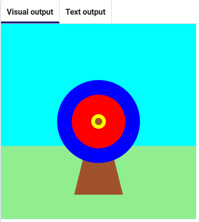

## Add an arrow

The arrow will be drawn using a function.

## Step 1

Add a function to draw a sienna coloured circle at coordinates `200`, `200`.

Add `global hit_colour` as the first line inside your `shoot_arrow()` function. Later, you will store the colour the arrow hits in `hit_colour`. The `global` keyword lets other functions use that value to work out your score.

```python line_numbers="true" line_number_start="9" line_highlights="10-15"
# The shoot_arrow function goes here
def shoot_arrow():
    global hit_colour  # Can be used in other functions
    arrow_x = 200
    arrow_y = 200
    fill('sienna')
    circle(arrow_x, arrow_y, 15)

```

## Step 2

Then call the function inside your `draw()` function.

```python line_numbers="true" line_number_start="36" line_highlights="38"
    fill('yellow')
    circle(200, 200, 30)
    shoot_arrow()

```

## Now run your code



Click the **Run** button and check that the arrow appears in the centre of the target.
