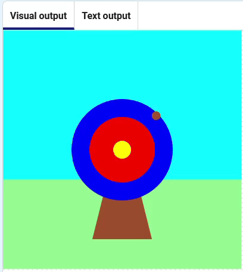

## Make the arrow move

➡️ Make the arrow appear at random positions on the screen.

Change the `arrow_x` and `arrow_y` variables so that each position is chosen by random numbers.

```python line_numbers="true" line_number_start="9" line_highlights="12-13"
# The shoot_arrow function goes here
def shoot_arrow():
    global hit_colour  # Can be used in other functions
    arrow_x = randint(100, 300)
    arrow_y = randint(100, 300)
    fill('sienna')
    circle(arrow_x, arrow_y, 15)

```

## Now run your code



Click the **Run** button and check that the arrow jumps around the target.
